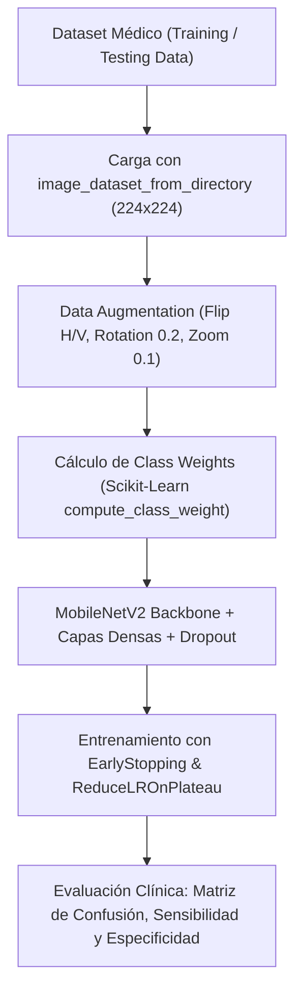

# Documentación Técnica: AI in HealthCare - Breast Cancer Detection
**Autor:** Roberto Alejandro Chagra Martínez  
**Tecnologías:** TensorFlow / Keras (MobileNetV2), OpenCV, Scikit-Learn, NumPy  
**Tipo:** Clasificador Convolucional de Imágenes Médicas (Oncología)  

---

## 1. Descripción del Proyecto
Sistema de asistencia diagnóstica basado en visión por computadora para la detección de cáncer de mama a partir de imágenes histopatológicas / mamografías. Emplea la red pre-entrenada **MobileNetV2** adaptada para transfer learning y solventa el desbalance crítico de clases común en datasets clínicos mediante ponderación estocástica.

---

## 2. Componentes del Pipeline
* `train_model.py`: Pipeline principal de entrenamiento. Calcula pesos con `compute_class_weight('balanced')` para equilibrar el gradiente, aplica data augmentation espacial y guarda los checkpoints del mejor modelo.
* `evaluate_model.py`: Genera métricas clínicas exhaustivas (Sensibilidad/Recall, Precisión, F1-Score y Curva ROC).
* `preparar_dataset.py`: Limpieza, separación y validación de integridad de los archivos de imagen.
* `app.py`: Módulo de inferencia para evaluar nuevas muestras diagnósticas.

---

## 3. Especificaciones del Modelo
* **Backbone:** `MobileNetV2(include_top=False, weights='imagenet')`
* **Capas Superiores:** `GlobalAveragePooling2D()` $\rightarrow$ `Dropout(0.3)` $\rightarrow$ `Dense(2, activation='softmax')`
* **Optimizador:** Adam con tasa inicial $10^{-4}$ y decaimiento dinámico.
